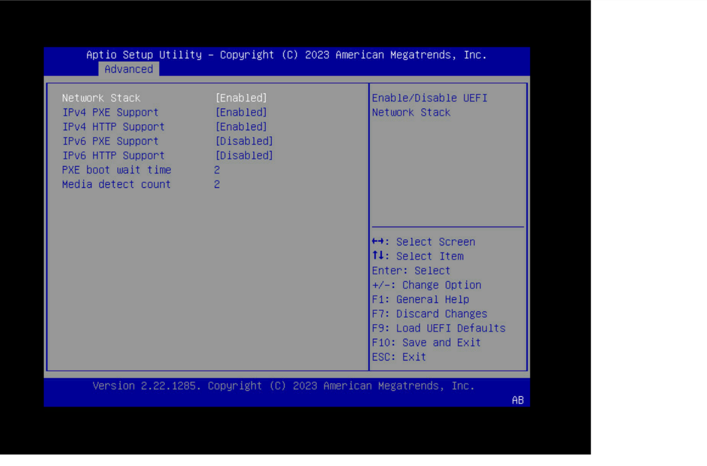
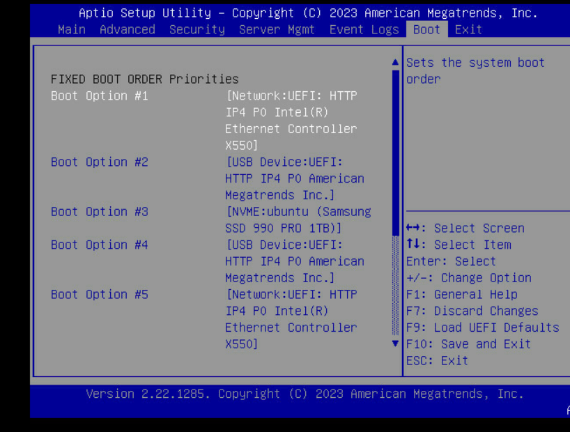

# Container Setup Guide

The following is the source deployment procedure, not a completed dragonvm provisioning test. The tracked `bifrost-infra/` container definition uses host networking and privilege; do not use it as a disposable lab fixture. Bifrost playbooks come from the image under `/opt/bifrost/playbooks`, not this repository. The separate [restricted lab smoke](https://github.com/DragonLord-64/experimental-fhs-baremetal/blob/development/ops/provisioning/README.md) passed only the empty Ironic API and KVM capability checks; full guest provisioning and physical hardware behavior remain untested.


This guide explains how to prepare your host machine and initialize the Bifrost container environment.

## 1. Host Prerequisites

Before running any setup scripts, your host machine must have the following installed and configured:

### Required Packages (Ubuntu/Debian)
```bash
sudo apt update
sudo apt install -y docker.io docker-compose-v2 qemu-system-x86 libvirt-daemon-system
```

### Hardware Requirements
* **Virtualization:** Ensure VT-x (Intel) or AMD-V (AMD) is enabled in your BIOS.
* **KVM:** The host must have the KVM kernel module loaded. Verify with:
  ```bash
  lsmod | grep kvm
  ```

---

## 2. Environment Initialization

The container requires specific files to exist on the host before it can start successfully.

### A. The Vault Password File
Ansible requires a password file for vaulted secrets. Even if you are not using secrets, the file **must exist** as a file (not a directory) to prevent Docker from mounting an empty directory.

```bash
# Create the file
# at project root
touch .vault_pass && chmod 600 .vault_pass

# Populate the file with your desired password
echo "<your_password>" > .vault_pass
```

### B. The Ironic Data Directory
A persistent directory is required on the host to store cached deployment images and master image hard-links.
```bash
sudo mkdir -p /var/lib/ironic
sudo mkdir -p /var/lib/ironic/httpboot/
# Place image in the httpboot directory.
```

---

## 3. Starting the Environment

You can start the environment using either the automated script or the manual method.

### Option 1: Automated (Recommended)
This is the fastest way to build the image, configure the environment, and start the services in one command.

```bash
# This script configures the environment, builds the container, and starts services
./scripts/deploy-bifrost-container.sh
```
*Note: You will still need to manually populate the `.vault_pass` file as described in Section 2A.*

### Option 2: Manual Method
Use this if you need to control the configuration or troubleshoot the build process.

**1. Configure Environment**
Copy the example environment file and set your absolute host paths.
```bash
cp .env.example .env
vi .env
```
*Note: Ensure `BIFROST_DIR` and `INVENTORY_DIR` are absolute paths (e.g., `/home/user/project/...`).*

**2. Build and Launch**
```bash
# Build the custom Bifrost image
sudo docker compose build

# Start the services in the background
sudo docker compose up -d
```

**3. Initialize the Services**
Once the container is running, you must run the installation playbook to set up Ironic, DNS, and HTTP services.
```bash
# Enter the container
sudo docker exec -it bifrost_deploy bash

```

If the command returns an empty table without errors, the container is successfully initialized. You can now proceed to the **[Operations](./operations.md) to enroll and deploy nodes.


# Terabox1501b (FHS) setup
All FHS BIOS must be configured to successfully integrate with bifrost and the provisioning process.

For information on the BMC IPMI interface see https://www.supermicro.com/manuals/other/IPMI_Users_Guide.pdf
For information on the motherboard BIOS and BMC firmware see https://www.asrockrack.com/general/productdetail.asp?Model=GENOAD8UD-2T/X550#Specifications

## BIOS Settings

The following settings must be applied in the FHS BIOS. The BIOS can be access on startup by holding the delete key when prompted by the boot screen.
Alternatively it is possible to access the bios settings directly from the BMC.

### BMC IP Settings
IPv4: <ip address for BMC>

### PXE Boot Settings
Enable PXE boot in network stack settings




Set the boot order
1. Network (PXE from)
2. NVME (Harddrive)




