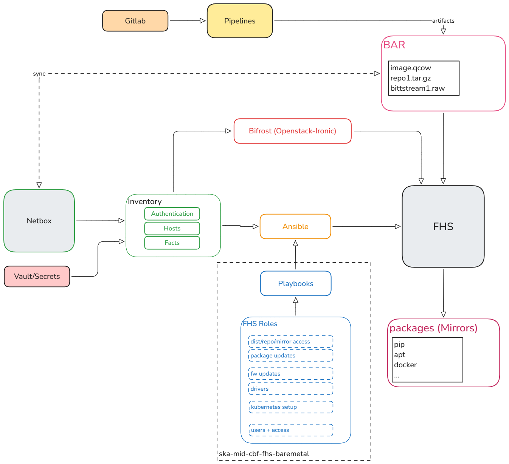
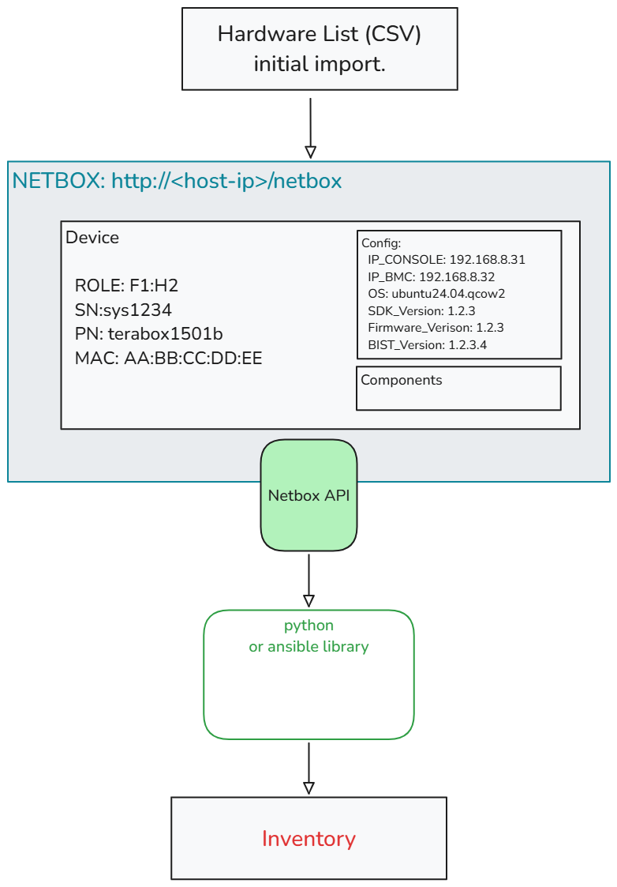
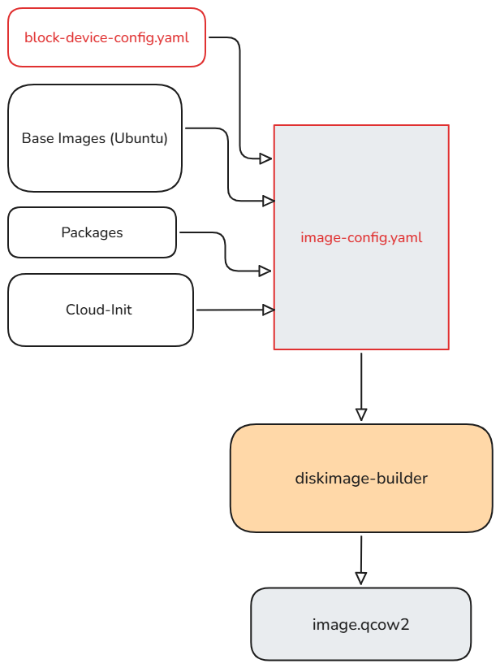
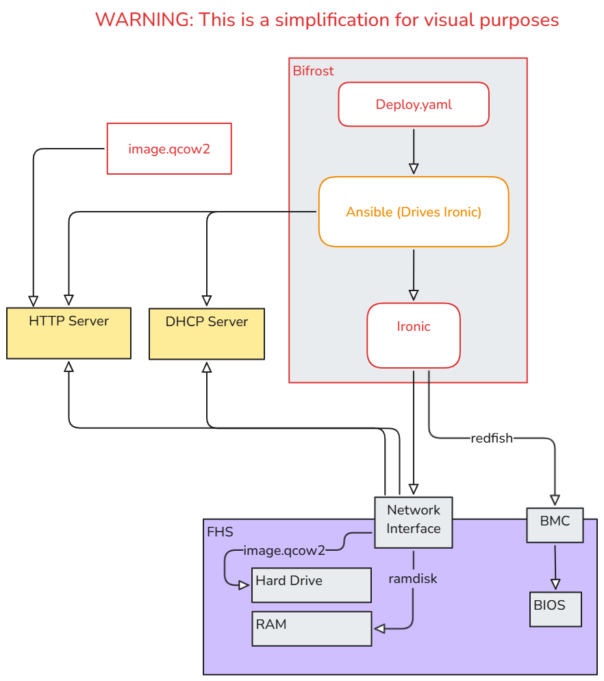
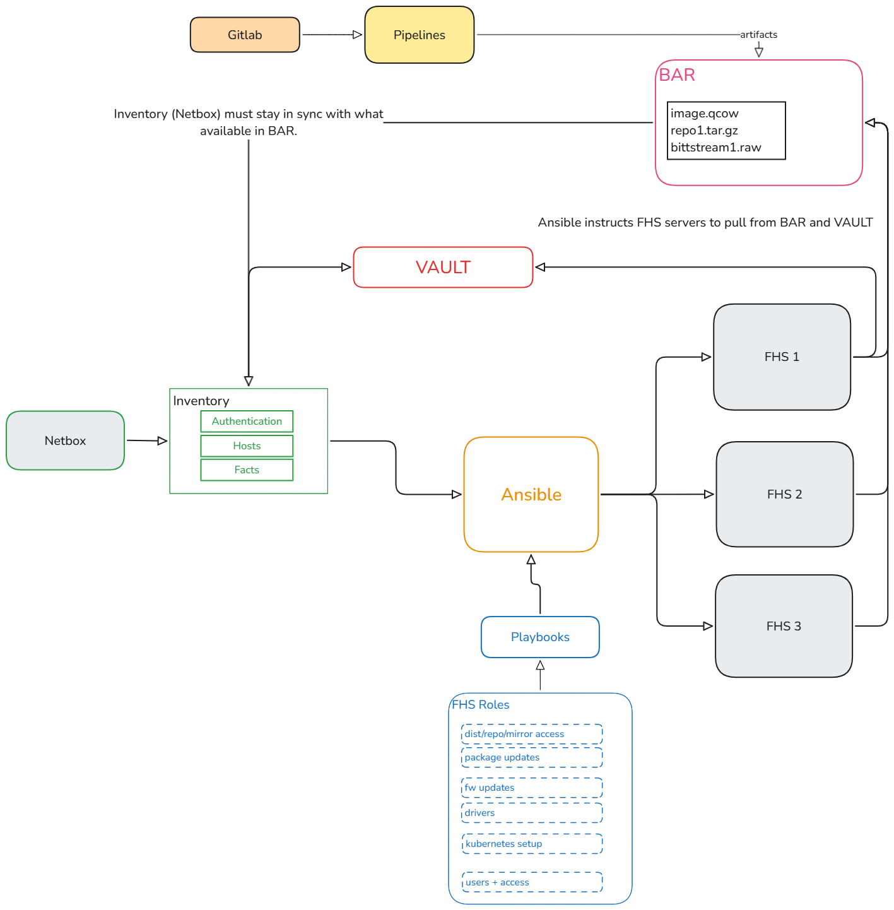

# Provisioning Architecture



The drawings describe the intended physical workflow. See [NetBox inventory and export](../guide/using_netbox_inventory.md) for discovery and export responsibilities.

## Strategy

The provisioning workflow is divided into three distinct stages:
1. **Netbox:** Used for DCIM (Data Center Infrastructure Management).
2. **Openstack:** Used to image a server to a known baseline state.
3. **Ansible:** Used to deploy custom configurations on the server.

### Definitions

| Component | Description |
| :--- | :--- |
| **Netbox** | Device/interface/address facts and selected desired configuration; credentials remain protected separately. |
| **Inventory** | Ansible dynamic inventory and Bifrost YAML export are separate outputs from NetBox records. **Note:** Netbox is the source of truth; files must be updated from Netbox before provisioning. *Development Note:* Inventory files can be saved/CM'd to maintain multiple different provisioned configurations. |
| **BAR** | SKA's artifact repository. The design places external artifacts (repos, tarballs, binaries and bitstreams) here; current roles also consume controller-local archives. Ansible pulls directly from BAR to FHS servers (no intermediate copy). BAR element names must sync with Netbox; if an artifact is missing, Ansible will fail loudly by design. |
| **Ansible** | The application used to provision the servers. |
| **Openstack/Ironic/Bifrost** | The application suite used to image the servers. |


### Deployment Interface & Exporting
  
The drawing proposes role-based naming and a later role-to-IP export for deployment placement and switch connectivity. That post-provisioning export is not established by the current source. The implemented `bifrost_export.yml` writes pre-provisioning Bifrost inventory only; it does not derive every hostname, label or address from a role name.

---

## Process Flow

1. **Inventory Creation** (Netbox)
2. **Image Building** (Bifrost/DiskimageBuilder)
3. **Server Enrollment** (Openstack/Bifrost)
4. **Server Imaging** (Openstack/Bifrost)
5. **Dependencies & Artifacts** (Gitlab, BAR, Platform)
6. **FHS Provisioning** (Ansible + Netbox)
7. **K8s Cluster Join**

---

## 1. Inventory Creation

NetBox supplies device, interface and address facts. Git supplies reusable defaults and protected controller files supply credentials.



### Mid.CBF Inventory File
Ansible polls NetBox through its inventory plugin; Bifrost consumes a separate exported YAML file. See the [inventory workflow](../guide/using_netbox_inventory.md) for selectors, credential ownership and output protection.

```yaml
example-fhs:
  name: example-fhs
  driver: redfish
  driver_info:
    redfish_address: "https://<BMC_ADDRESS>"
    redfish_username: "<REDFISH_USER>"
    redfish_password: "<REDFISH_PASSWORD>"
  nics:
    - mac: "02:00:00:00:00:01"
  ipv4_address: "192.0.2.10"
  properties:
    root_device:
      size: "> 900"
    capabilities: "boot_mode:uefi"
```

The example shows the export shape only. The export contains credentials and must remain private.


---

## 2. Building an Image

The Bifrost environment utilizes **DiskimageBuilder** to create base images.



### Image YAML Configuration
This defines the base image and filename. It references a block device configuration.

```yaml
---
- imagename: tb_jammy_2025_12_03.qcow2
  elements: [base, ubuntu, vm, growroot, block-device-efi-lvm, cloud-init-datasources]
  image-size: 925
  environment:
    DISTRO_NAME: ubuntu
    DIB_RELEASE: jammy
    DIB_CLOUD_INIT_DATASOURCES: "Ec2, ConfigDrive, OpenStack"
    DIB_BLOCK_DEVICE_CONFIG: file:///<path to block device file> # Three slashes required
```

### Block Device YAML Configuration
This section sets up the partitions on the hard drive using **LVM (Logical Volume Manager)**.

```yaml
- local_loop:
    name: image0
- partitioning:
    base: image0
    label: gpt
    partitions:
      - name: ESP
        type: EF00
        size: 512MiB
        mkfs:
          type: vfat
          mount:
            mount_point: /boot/efi
            fstab:
              options: "defaults"
              fsck-passno: 2
      - name: BSP
        type: 'EF02'
        size: 8MiB
      - name: root
        type: '8300' 
        flags: [boot]  
        size: 100%
- lvm:
    name: lvm
    base: [ root ]
    pvs:
      - name: pv
        base: root
        options: ["--force"]
    vgs:
      - name: vg
        base: ["pv"]
        options: ["--force"]
    lvs:
      - name: lv_root
        base: vg
        extents: 22%VG
      - name: lv_tmp
        base: vg
        extents: 4%VG
      - name: lv_var
        base: vg
        extents: 25%VG
      - name: lv_log
        base: vg
        extents: 16%VG
      - name: lv_audit
        base: vg
        extents: 5%VG
      - name: lv_home
        base: vg
        extents: 18%VG
- mkfs:
    name: fs_root
    base: lv_root
    type: xfs
    label: "img-rootfs"
    mount:
      mount_point: /
      fstab:
        options: "rw,relatime"
        fsck-passno: 1
# ... (subsequent mkfs entries follow same logic for /tmp, /var, /var/log, /var/log/audit, /home)
```

### Notes on Cloud-init
**Cloud-init** is a service that runs early in the Ubuntu startup process. It is responsible for configuring the initial IP address and user access provided during the image deployment stage.

---

The following Bifrost commands run inside the configured source container from `/opt/bifrost/playbooks`, with its inventory and credentials available. They are operational actions, not documentation checks.

## 3. Enrolling the Server

This is a Bifrost step to add servers to the Bifrost Ironic service in preparation for Openstack deployment.

```bash
# Set the inventory source
export BIFROST_INVENTORY_SOURCE=<path_to_mid-cbf-inventory.yml> 

# Enroll servers (use -vvvv for maximum logging verbosity)
ansible-playbook -vvvv -i inventory/bifrost_inventory.py enroll-dynamic.yaml 

# Note: bifrost_inventory.py is a helper script used by Bifrost to format the data correctly.
```

---

## 4. Server Imaging

Bifrost uses **PXE booting** (HTTP Boot) to prepare the server.



### The PXE Process
1. The FHS BIOS is instructed to search the network port for an image.
2. A **DHCP server** provides a temporary IP.
3. An **HTTP server** provides a **ramdisk image** (an OS stored entirely in RAM).
4. Once booted, an Ansible script wipes the existing hard drives.
5. The server is then configured to download and boot the target built image (from Step 2) provided via HTTP.

### Deployment Command
```bash
export BIFROST_INVENTORY_SOURCE=<inventory_file_path>.yml 
ansible-playbook -vvvv -i inventory/bifrost_inventory.py deploy-dynamic.yaml
```

### Initial Access
After the initial Ubuntu boot, **Cloud-init** configures the permanent IP and user credentials, allowing Ansible and system maintainers to access the server.

---

## 5. FHS Configuration via Ansible

Once the base image is deployed, Ansible installs and configures the following:
* Network stack
* Users and Access Control
* Drivers and Packages
* Mid.CBF Monitoring Services (Prometheus)
* DPDK
* Kubernetes
* BIST



Ansible allows for simultaneous configuration of multiple servers. **Variables** are utilized to provide unique configurations for each FHS, while **Ansible Roles** are used to ensure the process is modular and organized.

---

## 6. Joining K8s Cluster

Cluster joining is a subsequent operational step; the documented source does not establish an automatic completed join.

`setup_fhs_node` prepares node dependencies; do not infer a completed cluster join from `site.yml`. Cluster joining and placement require a separately verified operational procedure.
