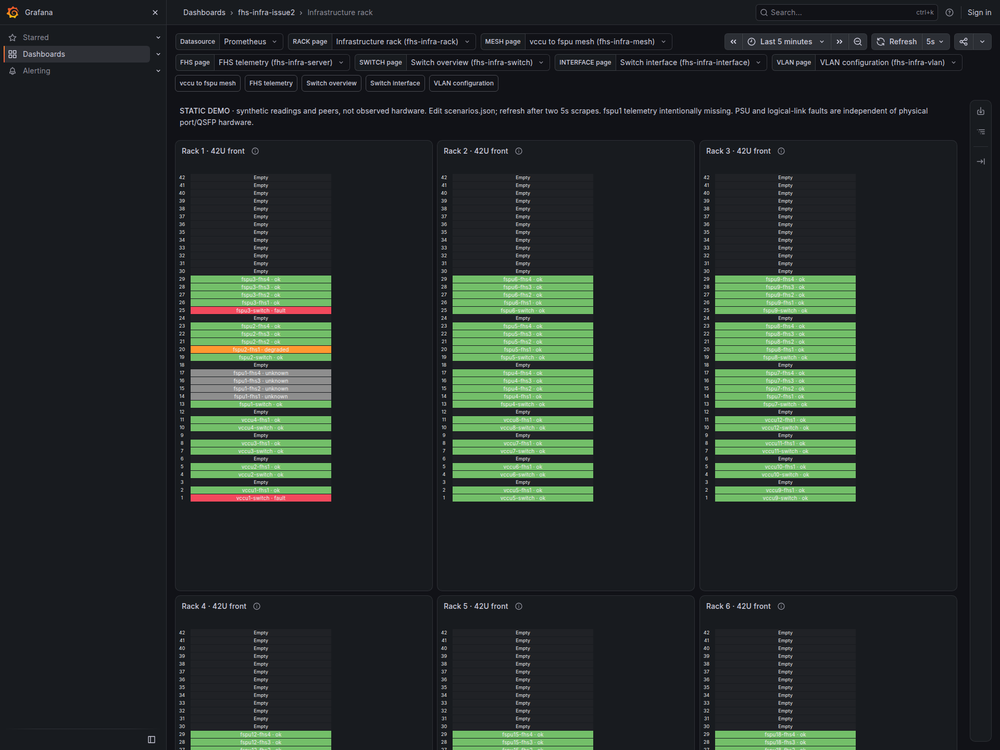
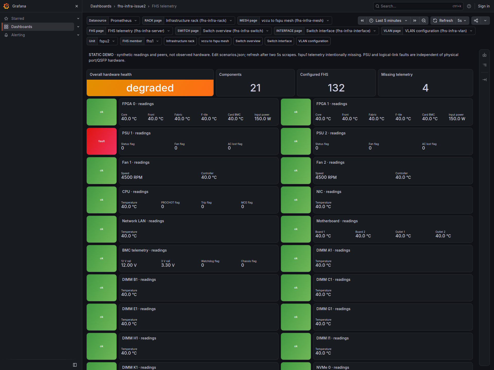
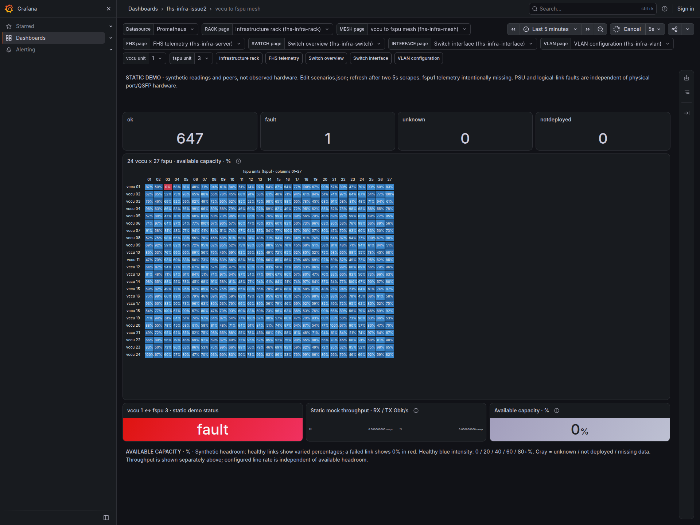
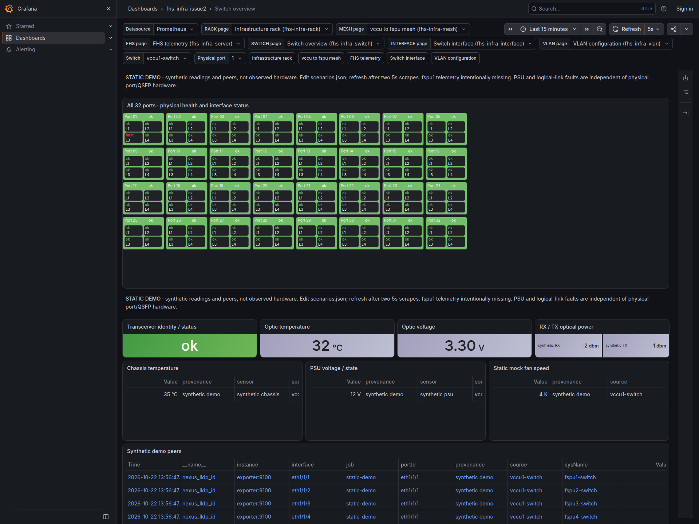
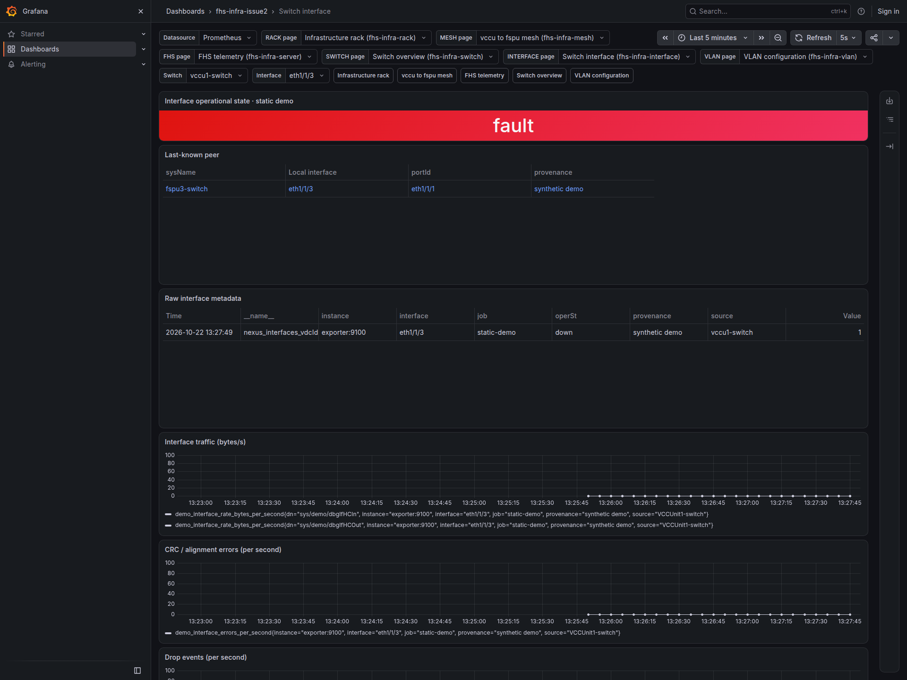
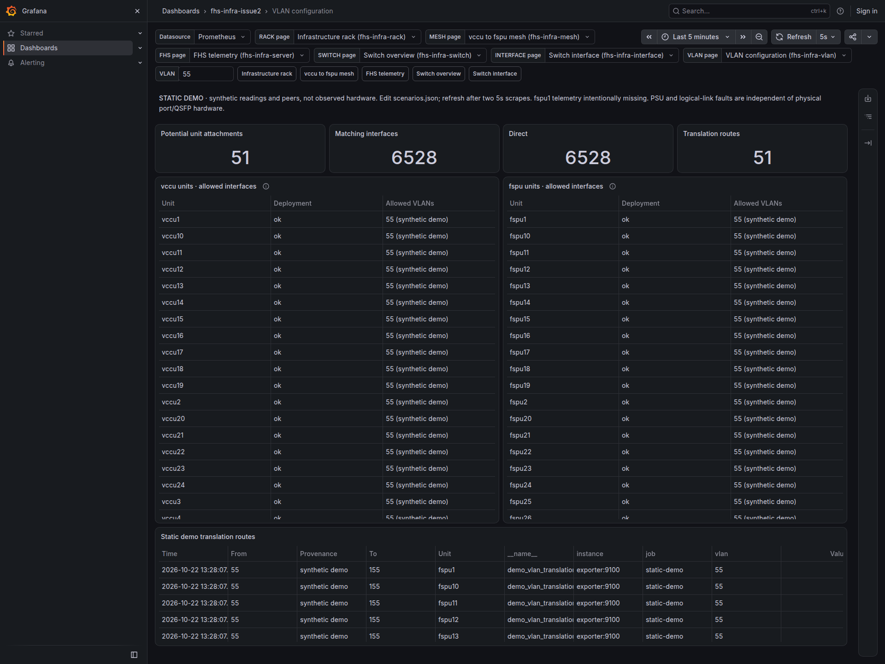

# Grafana static demo

Docker Engine and the Docker Compose plugin are required. This folder is
self-contained: no checkout, host Python, packages or downloaded scripts at launch.
Only pinned container images are downloaded; the stdlib exporter builds locally.

```sh
./launch.sh
# optional: GRAFANA_PORT=13001 ./launch.sh
```

Open http://127.0.0.1:13000/d/fhs-infra-rack. All six native dashboards and their
navigation are provisioned. Local anonymous Viewer access is enabled; login is
disabled. `local-demo` / `local-demo-only` is public bootstrap configuration,
not a real credential. Keep the loopback binding. Prometheus/exporter are internal.

## Screenshots

All six dashboards with synthetic demo data:

Rack overview — server and switch status across the rack.



FHS detail — component status and readings for one server.



Mesh capacity — available capacity (%) across the switch mesh.



Switch ports — physical ports and transceiver status.



Interface detail — link status, peer and traffic for one interface.



VLAN detail — VLAN status and interface membership.



## Edit and refresh

`scenarios.json` uses `ok`, `degraded`, `fault`, `unknown`, `notdeployed`.
`defaults.status` populates the inventory; named entries override it. Examples:

```json
"servers": {"fspu2-fhs1": {"status": "degraded", "components": {"psu1": "fault"}}},
"physical_ports": {"vccu1-switch": {"1": "fault"}},
"transceivers": {"vccu1-switch": {"1": "ok"}},
"interfaces": {"vccu1-switch": {"eth1/1/3": "ok"}},
"switches": {"vccu1-switch": "ok"}
```

These are examples of sections, not a replacement for the entire source. Edit
existing entries to keep the intentional scenarios. Server overall status is
independent of components: change both `fspu2-fhs1.status` and
`fspu2-fhs1.components.psu1` for the PSU fault→ok experiment.

Each `links` entry defines two interfaces and one mesh cell. Unlisted pairs use
synthetic full-mesh cabling: peer number N maps to port `1+(N-1)/4` (integer
division), lane `1+(N-1)%4`. Link edits drive both ends and mesh together.
An `interfaces` override on either linked end also drives both ends/mesh;
conflicting endpoint overrides are rejected. Interface overrides take precedence
over link status. Physical port and shared QSFP status remain independent.
Rack switch tiles summarize chassis, interfaces, physical ports and QSFPs:
fault takes priority over degraded, unknown, notdeployed and ok. A failed link
marks both endpoint switches as fault; restoring it clears their fault when
all other members are ok. `switches` edits only the independent chassis status.
Unused interface slots have synthetic peer names, not real cabling.

Save a complete file beside the original, then atomically rename it over
`scenarios.json`. The directory mount makes replacement visible. Each `/metrics`
request rereads and validates the file. Invalid JSON/schema returns HTTP 503 and
Prometheus marks the scrape down; correct the file to recover. No stale exporter
cache is served. Allow two 5-second scrape/refresh cycles or click Refresh.
No rebuild or restart is needed.

## Provenance and limits

**STATIC DEMO ONLY:** all readings, rates, optics and peers are synthetic
mock data, not observed hardware, protocol emulation or a live cluster. All nine
racks, 132 FHS, 51 switches, 648 mesh cells and 32×4 interfaces per switch are
populated. Four vccu / three fspu retain the scenario identities as static replay.
Only fspu1's four FHS intentionally lack telemetry. fspu2-fhs1 is degraded with
PSU1 fault; vccu1-switch eth1/1/3 ↔ fspu3-switch eth1/1/1 is fault. That port and
QSFP hardware remain ok; both rack switch tiles show the operational fault.
Everything else defaults to explicit synthetic ok.

`defaults.mock_readings` enables catalog readings and bounded synthetic rate gauges
consumed directly by demo queries. Set false to omit default numbers. Optional `readings`
entries override a native server metric with `server`, `component`, `metric`,
finite numeric `value`, and `provenance: "synthetic demo"`. See
`exporter/components.json` for component keys (compact lowercase titles) and units.
Links optionally accept `rate_bps` (default 1e9) and `capacity_bps` (default 1e11);
0 ≤ rate ≤ capacity is required. Both ends emit zero rate at fault/unknown/notdeployed.
The mesh shows **available capacity (%)**: healthy links use varied, deterministic
synthetic percentages, failed links show **0%** in red, and unknown/notdeployed or
missing data is gray with no numeric capacity. Optional link
`available_capacity_percent` sets a healthy/degraded value (finite 0–100); fault
always forces zero. The first healthy cells show 87% and 50%; the failed cell
returns to its configured 45% when restored. This headroom is synthetic, not
calculated from traffic. `capacity_bps` remains the configured physical line rate
even on a failed link. The selected-link capacity panel also shows available
capacity in percent; selected-link throughput remains separate in Gbit/s. `mock_readings: false` suppresses mesh capacity numbers.
No CPU/memory workload is simulated. Six native layouts/UIDs/links are copied;
demo-only adapters provide status/optic/capacity/VLAN values where source queries
had no data. Source provenance is in `tests/source-provenance.json`.

```sh
# use the same COMPOSE_PROJECT_NAME / GRAFANA_PORT overrides as launch:
docker compose stop
# remove only this project's containers, network and owned data volumes:
docker compose down --volumes
```

Launch reruns are idempotent. An occupied port gives an error and port-selection
hint without teardown. Readiness is bounded. Limits: Grafana 768 MiB,
Prometheus 256 MiB (one-hour retention, two concurrent queries), exporter 64 MiB
(one HTTP worker). Only Grafana publishes a loopback port. No Docker socket,
privileged devices, host network, real inventory or credentials are used.

Offline/HTTP checks: `python3 tests/test_unit.py`. The supervisor's bounded
`tests/validate_runtime.py` uses its own Docker/browser test tooling; these are
not launch dependencies. ZIP and runtime evidence are written outside this folder.
